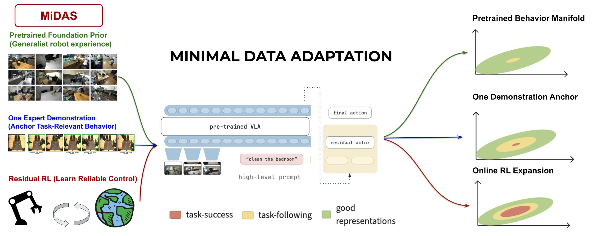

# MiDAS: Minimal-Data Adaptation for Generalist Robot Policies

[Paper](https://arxiv.org/abs/2608.11363) · [PDF](https://arxiv.org/pdf/2608.11363)

Shreyas Kowshik, Sreyas Venkataraman, Leo Wang, Niharika Pant, Max Simchowitz, and Aviral Kumar

MiDAS adapts a frozen vision-language-action policy to a new task from one
demonstration and autonomous online interaction. It combines behavior cloning
with value-based residual reinforcement learning over frozen VLA features.



## Install

```bash
git clone --recurse-submodules https://github.com/minimal-data-adaptation/midas.git
cd midas
git submodule update --init --recursive
```

### LIBERO

```bash
conda env create -f environment-libero.yml
conda activate midas-libero
bash scripts/install_profile.sh libero
python -m pip install -r requirements/jax-cuda.in

export LIBERO_CONFIG_PATH="$HOME/.config/libero-pro"
mkdir -p "$LIBERO_CONFIG_PATH"
bash scripts/smoke_cpu.sh
```

### RoboCasa

```bash
conda env create -f environment-robocasa.yml
conda activate midas-robocasa
bash scripts/install_profile.sh robocasa
python -m pip install -r requirements/jax-cuda.in
python robocasa/robocasa/scripts/download_kitchen_assets.py --type all
bash scripts/smoke_cpu.sh
```

## Configure

Create `${XDG_CONFIG_HOME:-$HOME/.config}/midas/experiments.env`:

```bash
export MIDAS_REPO_DIR="<absolute-path-to-midas>"
export MIDAS_DATA_ROOT="<absolute-path-to-writable-storage>"
export MIDAS_SHARED_DATA_ROOT="<absolute-path-to-shared-datasets>"
export MIDAS_CONDA_SH="$(conda info --base)/etc/profile.d/conda.sh"

export MIDAS_LIBERO_CONDA_ENV="midas-libero"
export MIDAS_ROBOCASA_CONDA_ENV="midas-robocasa"

export ROBOCASA_EVAL_DATA_ROOT="<absolute-path-to-robocasa-evaluation-data>"
export OPENPI_DATASET_ROOT="$MIDAS_DATA_ROOT/robocasa_assets"
export OPENPI_ASSETS_ROOT="$MIDAS_DATA_ROOT/openpi_bc_assets"
export OPENPI_CHECKPOINT_ROOT="$MIDAS_DATA_ROOT/openpi_bc_checkpoints"
export OPENPI_DATA_HOME="$OPENPI_DATASET_ROOT/openpi_cache"

export WANDB_ENTITY="<wandb-entity>"
export MIDAS_WANDB_ENTITY="$WANDB_ENTITY"
```

```bash
source "${XDG_CONFIG_HOME:-$HOME/.config}/midas/experiments.env"
cd "$MIDAS_REPO_DIR"
```

## Train

### LIBERO behavior cloning

One-demo training scripts for all 10 tasks are in
[experiments/behavior_cloning](experiments/behavior_cloning/README.md).

```bash
OPENPI_BC_EXP_NAME=both_mokapots_ep1_bc OPENPI_BC_NUM_TRAIN_STEPS=16000 \
  sbatch --gres=gpu:4 --export=ALL \
  experiments/behavior_cloning/libero/run_bc_both_mokapots_stove_ep1.slurm
```

```bash
cd "$MIDAS_REPO_DIR"
CONFIG=pi05_libero10_both_mokapots_stove_ep1
EXP_NAME=both_mokapots_ep1_bc
# Training step indices start at zero: a 16,000-step run ends at 15999.
BC_CHECKPOINT="$OPENPI_CHECKPOINT_ROOT/pi05_checkpoints_libero10/$CONFIG/$EXP_NAME/15999"
sbatch --export=ALL,T_CKPT="$BC_CHECKPOINT" \
  experiments/libero/run_midas_task8_both_mokapots_stove_ep1.slurm
```

### LIBERO MiDAS

One launcher per task: [experiments/libero](experiments/libero/README.md).
Set `T_CKPT` to the matching task's BC checkpoint.

```bash
sbatch --export=ALL experiments/libero/run_midas_task8_both_mokapots_stove_ep1.slurm
MIDAS_SEED=11 sbatch --export=ALL experiments/libero/run_midas_task8_both_mokapots_stove_ep1.slurm
MIDAS_SEED=42 sbatch --export=ALL experiments/libero/run_midas_task8_both_mokapots_stove_ep1.slurm
```

### RoboCasa behavior cloning

```bash
sbatch --export=ALL experiments/behavior_cloning/robocasa/run_bc_pick_place_counter_to_cabinet_exact_replay_l1_s1_ep32.slurm
sbatch --export=ALL experiments/behavior_cloning/robocasa/run_bc_pick_place_fridge_drawer_to_shelf_l50_s37.slurm
sbatch --export=ALL experiments/behavior_cloning/robocasa/run_bc_prepare_coffee_l25_s29.slurm
```

### RoboCasa MiDAS

```bash
sbatch --export=ALL experiments/robocasa/run_midas_pick_place_counter_to_cabinet_exact_replay_l1_s1_ep32_paper_v2.sh
sbatch --export=ALL experiments/robocasa/run_midas_pick_place_fridge_drawer_to_shelf_l50_s37_paper_v2.slurm
sbatch --export=ALL experiments/robocasa/run_midas_prepare_coffee_l25_s29_var1_paper_v2.slurm
```

## Evaluate

### LIBERO

```bash
sbatch --export=ALL experiments/libero/legacy/eval_midas_task8_both_mokapots_checkpoint250000_no_perturbations.slurm
sbatch --export=ALL experiments/libero/legacy/eval_midas_task8_both_mokapots_checkpoint250000_object_perturbation.slurm
sbatch --export=ALL experiments/libero/legacy/eval_midas_task8_both_mokapots_checkpoint250000_language_perturbation.slurm
sbatch --export=ALL experiments/libero/legacy/eval_midas_task8_both_mokapots_checkpoint250000_position_5cm_perturbation.slurm
bash experiments/libero/legacy/submit_midas_task8_checkpoint200000_eval_matrix.sh
```

### RoboCasa behavior cloning

```bash
sbatch --export=ALL experiments/evals/behavior_cloning/eval_bc_pick_place_counter_to_cabinet_checkpoint8000_50rollouts.slurm
```

## Test

```bash
conda activate midas-libero
bash scripts/smoke_cpu.sh
```

```bash
conda activate midas-robocasa
bash scripts/smoke_cpu.sh
```

## Citation

```bibtex
@misc{kowshik2026midas,
  title         = {What Does It Take For A Generalist Robot Policy To Adapt From Minimal Data?},
  author        = {Kowshik, Shreyas and Venkataraman, Sreyas and Wang, Leo and Pant, Niharika and Simchowitz, Max and Kumar, Aviral},
  year          = {2026},
  eprint        = {2608.11363},
  archivePrefix = {arXiv},
  primaryClass  = {cs.RO},
  url           = {https://arxiv.org/abs/2608.11363}
}
```

## License

MIT. See [LICENSE](LICENSE).
